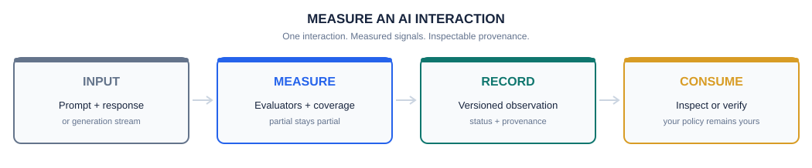

<div align="center">

[](README.md) · [](README_FR.md)

# NeoMundi Measurement

### Turn AI behavior into measurable signals.

**Know what was measured. Keep the evidence.**

**Measure AI behavior at runtime and monitor its evolution across instrumented interactions.**

Use post-call REST measurements or the SSE generation proxy to inform operational decisions in your existing systems. Policy and enforcement remain with the integrating application.

This repository documents the **measurement instrument** itself: the REST and SSE contracts, the signals, their provenance and their unavailable states. A signal that was not measured is never published as a number.

[Product architecture](https://github.com/neomundi-io/.github/blob/main/docs/PRODUCT_ARCHITECTURE.md) · [Capability audit](https://github.com/neomundi-io/.github/blob/main/docs/V2_FUNCTIONAL_AUDIT_2026-11-15.md) · [All components](https://github.com/orgs/neomundi-io/repositories)

**Independent AI measurement infrastructure for your existing systems.**

**INSTALL → TRACE → MEASURE → VERIFY → ACT**

[](https://github.com/neomundi-io/neomundi-runtime-measurement)
[](https://github.com/neomundi-io/neomundi-integrations)
[](https://github.com/neomundi-io/neomundi-station-public)
[](https://github.com/neomundi-io/neomundi-evidence-gateway)
[](https://github.com/neomundi-io/neomundi-use-cases)

**[Get your first measurement](QUICKSTART.md)** · **[Explore use cases](https://github.com/neomundi-io/neomundi-use-cases)** · **[Create an account](https://controltower.neomundi.io/welcome)**

**[neomundi.io](https://neomundi.io/)**

</div>

---

## Documentation and integrations

[Start here](START_HERE.md) · [First measurement](QUICKSTART.md) · [API guide](API_INTEGRATION_GUIDE.md) · [Signals](docs/MEASUREMENT_CONTRACT.md) · [Interoperability](docs/INTEROPERABILITY.md) · [Python SDK](https://github.com/neomundi-io/neomundi-python-sdk) · [Framework integrations](https://github.com/neomundi-io/neomundi-integrations) · [MCP](https://github.com/neomundi-io/neomundi-measurement-mcp)

Technical capability status (REST, SSE, interoperability, SDK and MCP) is covered under [Integration status](#integration-status).

---


## Attach it to the stack you already run

**Integrate with your existing AI stack.** One measurement API. Seven integrations. Verifiable evidence.

The contracts documented here are what an integration speaks. If your application already runs one
of these hosts, you do not have to speak them yourself — attach the measurement at the hook the host
already gives you, and the observation carries the latency and the token count **that host actually
observed**.

| Your stack | Package | Evidence |
|---|---|---|
| LangChain | [`langchain-neomundi`](https://pypi.org/project/langchain-neomundi/) | **E2** |
| LiteLLM | [`litellm-neomundi`](https://pypi.org/project/litellm-neomundi/) | **E2** |
| MLflow | [`mlflow-neomundi`](https://pypi.org/project/mlflow-neomundi/) | **E2** |
| Microsoft Agent Framework | [`agent-framework-neomundi`](https://pypi.org/project/agent-framework-neomundi/) | **E2** |
| OpenAI Agents SDK | [`openai-agents-neomundi`](https://pypi.org/project/openai-agents-neomundi/) | **E2** |
| OpenTelemetry | [`otel-neomundi`](https://pypi.org/project/otel-neomundi/) | **E2** |
| Langfuse | [`langfuse-neomundi`](https://pypi.org/project/langfuse-neomundi/) | **E2** |

**E2** is computed, not claimed: CI opens a proof file under the integration's `evidence/` and
compares its numbers to what the manifest asserts. It means real calls executed against this API and
re-read as persisted.

**[Integration library](https://github.com/neomundi-io/neomundi-integrations)** ·
**[Catalogue](https://github.com/neomundi-io/neomundi-integrations/blob/main/CATALOG.md)**

## From an AI interaction to an inspectable measurement

<p align="center">
  <picture>
    <source media="(prefers-color-scheme: dark)" srcset="https://raw.githubusercontent.com/neomundi-io/neomundi-runtime-measurement/main/docs/assets/measurement-en-dark.svg">
    
  </picture>
</p>

The same instrument supports REST measurements of an existing response and SSE generation with measurements. A transport success does not imply that every signal was measured. The receiving system retains authority over interpretation and action.

---

## The NeoMundi product chain

**Measurement → Station → Evidence** — three complementary products along that path, one coherent route from measuring AI behaviour to independently checking its technical evidence. The five steps above are the user journey; these three are the components that serve it.

| Step | Product | Purpose |
|---|---|---|
| **1 · Measure** | [Measurement](https://github.com/neomundi-io/neomundi-runtime-measurement) | Capture versioned measurement results, status and evaluator coverage. Access through [REST API](https://github.com/neomundi-io/neomundi-runtime-measurement), [Python SDK](https://github.com/neomundi-io/neomundi-python-sdk) or [MCP](https://github.com/neomundi-io/neomundi-measurement-mcp). |
| **2 · Contextualise** | [Station](https://github.com/neomundi-io/neomundi-station-public) | Organise controlled observations and campaigns, retain provenance and export records. |
| **3 · Verify** | [Evidence](https://github.com/neomundi-io/neomundi-evidence-gateway) | Check archive integrity, trace artefacts and verify signed attestations. [User guide](https://github.com/neomundi-io/neomundi-evidence-gateway/blob/main/verifier/README.md) · [Technical demo](https://github.com/neomundi-io/neomundi-evidence-gateway/blob/main/verifier/README.md#verify-our-figures--the-four-commands). |

**Take the next step:** [Explore Station](https://github.com/neomundi-io/neomundi-station-public) · [Verify with Evidence](https://github.com/neomundi-io/neomundi-evidence-gateway) · [Discuss a pilot](mailto:contact@neomundi.io).

The chain has been exercised on a real experimental Q-2 case with an Ed25519 attestation. Its technical checks passed; the global Q-2 verdict remains **PARTIAL**. The frozen Q-2 corpus is private, not a public demo.

---

NeoMundi measures an AI execution under declared conditions and returns a structured, timestamped measurement record. Your system can retain the record, compare compatible observations, or request a signed interoperability contract for independent verification.

NeoMundi does **not** decide whether your application should allow, block, reroute or approve anything. Interpretation, policy and execution remain with the consuming system.

```text
Measurement ≠ Interpretation ≠ Policy ≠ Execution
```

## Choose your path

| Goal | Path | Start |
|---|---|---|
| Measure an answer you already produced | REST `POST /v1/govern` | [Quickstart](QUICKSTART.md) |
| Generate through NeoMundi and receive streamed events | SSE `POST /v1/govern/stream` | [API guide](API_INTEGRATION_GUIDE.md#3-step-1--v1governstream-get-the-model-response) |
| Integrate from Python | Python SDK | [SDK](https://github.com/neomundi-io/neomundi-python-sdk) |
| Measure from an agent | MCP connector | [MCP](https://github.com/neomundi-io/neomundi-measurement-mcp) |
| Validate a portable record | JSON Schema + signature verification | [Interoperability](docs/INTEROPERABILITY.md) |
| Use the hosted instrument | NeoMundi Station | [Station](https://github.com/neomundi-io/neomundi-station-public) |

## Get your first measurement

The primary path measures an execution you already hold. It does not ask NeoMundi to generate the answer and does not require a provider API key.

```bash
curl -X POST "https://api.neomundi.io/v1/govern" \
  -H "X-API-Key: YOUR_NEOMUNDI_KEY" \
  -H "Content-Type: application/json; charset=utf-8" \
  -d '{
    "source_type": "llm",
    "mode": "OBS",
    "llm_prompt": "What is the capital of France?",
    "llm_response": "Paris.",
    "raw_metrics": {"token_count": 1, "latency_ms": 120}
  }'
```

The `token_count: 1` and `latency_ms: 120` values above are illustrative placeholders, not measured data and not values captured from a live observation.

The route and request fields are confirmed by existing integration material. No response values are shown because this documentation change did not perform a new live API call. Preserve the raw response, its versions, and every partial or unavailable state; never replace a missing value with zero.

[**Follow the complete REST path →**](QUICKSTART.md)

## What NeoMundi measures

NeoMundi reports bounded behavioral and operational signals for one observation. Depending on the deployed measurement version and available checks, records may expose signals related to stability, coherence, factuality, semantic variability or risk.

The Metric Contract vocabulary, experimental `G`/`g_score`/`∆G` material and RGC fields are distinct vocabularies. No undocumented mapping is implied. Read the [Measurement Contract](docs/MEASUREMENT_CONTRACT.md) and [Interpretation Table](docs/MEASUREMENT_INTERPRETATION_TABLE.md).

## How it works

```text
Your AI execution
       ↓
NeoMundi Measurement API
       ↓
Versioned measurement record
       ├──── optional signed interoperability contract
       ↓
Your storage, interpretation, policy and action
```

The API includes a historical field named `governance.decision`. Values such as `ALLOW`, `FLAG`, `REROUTE`, `HUMAN_REVIEW` or `STOP` are measurement-layer signals—not permissions, commands or actions executed by NeoMundi. The interoperability schema constrains `execution_permission_changed` to `false`.

## What your system receives

A response may include an identifier and timestamp, version and provenance information, measured values, status and coverage, limitations, and advisory fields. For portable exchange, request a versioned JSON contract, validate it against the matching schema, and verify its SHA-256 fingerprint and Ed25519/JWS signature.

## Integration status

Checked against the linked repositories on **28 November 2026**.

| Path | Status | Evidence and limit |
|---|---|---|
| REST API | **Available; examples qualified** | Route and fields are confirmed. Response values remain illustrative until captured live. |
| SSE API | **Available alternative** | NeoMundi calls the provider and receives its credential for that call. Not required for an existing execution. |
| Python SDK 2.2.0 | **Live-qualified 2026-11-26: REST passed, SSE passed** | Qualified against production at `measurement_version` 3.5.0 — four authorised REST calls covering both runtime metrics present, each absent and both absent, plus one authenticated SSE stream. It did **not** exercise a withheld aggregate, an error path (402, 429…) or more than one SSE provider. [Evidence](https://github.com/neomundi-io/neomundi-python-sdk/tree/main/docs/evidence/) |
| Local MCP plugin 0.2.0 | **Pilot-evaluated** | One bounded REST/SSE live qualification completed on 26 October 2026. |
| MCP 0.3.0-rc.1 source | **Release candidate** | Response-schema validation added; companion backend deployment and fresh qualification required. |
| Hosted MCP | **Transport validated; contract pending** | Local plugin evidence does not qualify the separate hosted server. |
| Interop v0.1 | **Historical, signed, re-verified** | Two bundled examples pass schema, hash and signature checks. |
| Interop v0.2 | **Schema available; examples illustrative** | Fixtures validate structurally but are explicitly unsigned and are not live observations. |

## Data, privacy and provenance

Keep three boundaries separate:

1. **Data submitted for measurement.** REST may include prompt and response text. SSE sends generation arguments and a configured provider credential upstream.
2. **Internal processing.** Submitted material may be processed by enabled evaluators and services. Retention and destinations depend on the deployment.
3. **Interoperability disclosure.** The signed exchange contract excludes raw prompts, responses and provider/model identifiers by schema design.

An export without raw text does not prove no raw text was processed upstream. Review [Data and confidentiality](https://github.com/neomundi-io/neomundi-io-data-protection).

## Trust, Compliance & Data Protection

Runtime Measurement supplies bounded technical evidence: measurements, coverage, provenance, unavailable states and optional signed exchange records. That evidence may support governance or compliance work, but it is not a conformity assessment, legal decision or certification.

- [**AI Act & GDPR — Operational Evidence**](https://github.com/neomundi-io/ai-act-rgpd) — maps the technical contribution to compliance processes and keeps legal responsibilities out of the measurement layer.
- [**Data Protection & Confidentiality**](https://github.com/neomundi-io/neomundi-io-data-protection) — documents what may be transmitted to the API and evaluators, what Station records or withholds, and why retention must be verified per deployment.

## Evidence

- Two historical v0.1 contracts were independently re-verified for schema, SHA-256 hash and Ed25519/JWS signature.
- v0.2 schemas enforce explicit partial and unavailable states.
- v0.2 fixtures are unsigned illustrations, not production observations.
- The Python verifier was cross-checked on the signed v0.1 examples.
- End-to-end example code is not qualified as a production client.

See [source status](source-notes/SOURCE_STATUS.md) for provenance and evidentiary weight.

## Architectural boundaries

NeoMundi does not provide a universal truth verdict, safety certification, compliance determination, policy engine or automatic enforcement mechanism.

```text
high stability ≠ factual correctness
FLAG ≠ proven error
ALLOW ≠ proven truth or permission
single observation ≠ drift
```

## Documentation

| Document | Purpose |
|---|---|
| [START_HERE.md](START_HERE.md) | Select an integration path. |
| [QUICKSTART.md](QUICKSTART.md) | Obtain a REST measurement and optional contract. |
| [API_INTEGRATION_GUIDE.md](API_INTEGRATION_GUIDE.md) | REST, SSE, errors and verification. |
| [Measurement Contract](docs/MEASUREMENT_CONTRACT.md) | Signal meanings and limits. |
| [Interoperability](docs/INTEROPERABILITY.md) | Contract, versions and verification. |
| [Consumer Boundaries](docs/CONSUMER_BOUNDARIES.md) | Measurement versus policy and action. |
| [VERSIONING.md](VERSIONING.md) | Version schemes and unresolved differences. |
| [schema/](schema/) | Authoritative v0.1 and v0.2 schemas. |
| [reference/python/](reference/python/) | Pedagogical integration and verifier. |

## Infrastructure & Program Support

NeoMundi's independent AI observation and measurement initiative benefits from infrastructure and startup program support:

- **[Infomaniak](https://www.infomaniak.com/)** — Infrastructure partner supporting the development of NeoMundi's independent AI observation instrument.
- **[OVHcloud Startup Program](https://startup.ovhcloud.com/)** — Startup support program participant.
- **[NVIDIA Inception](https://www.nvidia.com/en-us/startups/)** — Member of NVIDIA's program for innovative startups.

These relationships support NeoMundi's development and do not imply certification or endorsement of its scientific results.

## Known limitations

- API response values are illustrative unless identified as real signed examples.
- No official mapping reconciles the Metric Contract, experimental `G` vocabulary and RGC fields.
- `metric_version` and `measurement_version` are not reconciled.
- A signed v0.1 example combines `complete` with coverage `0.6`; preserve it as history, not a v0.2 template.
- One observation establishes neither trend nor drift.
- Deployment-wide evaluator destinations, retention and deletion guarantees are not established here.
- SDK, local MCP and hosted MCP have different qualification states.

---

**One measurement primitive. Multiple applications. Multiple infrastructures.**

> **Your system. Your decisions. Our measurement signal.**
